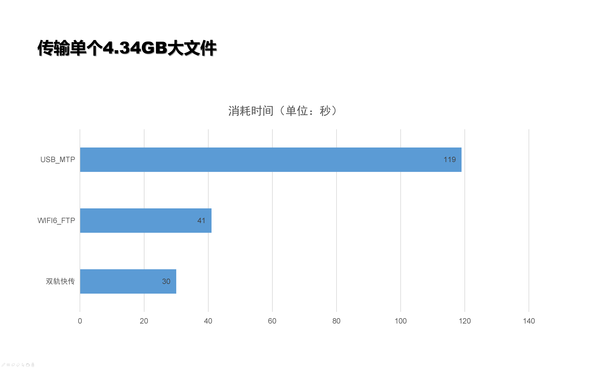
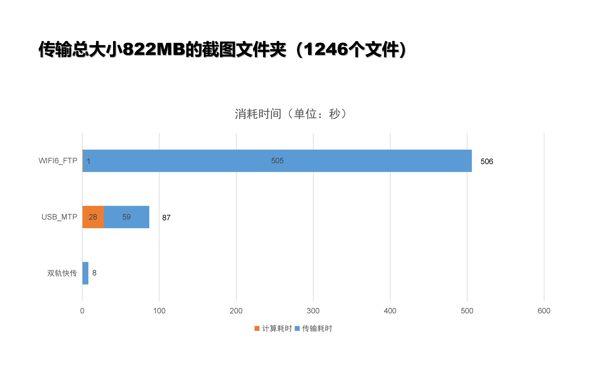
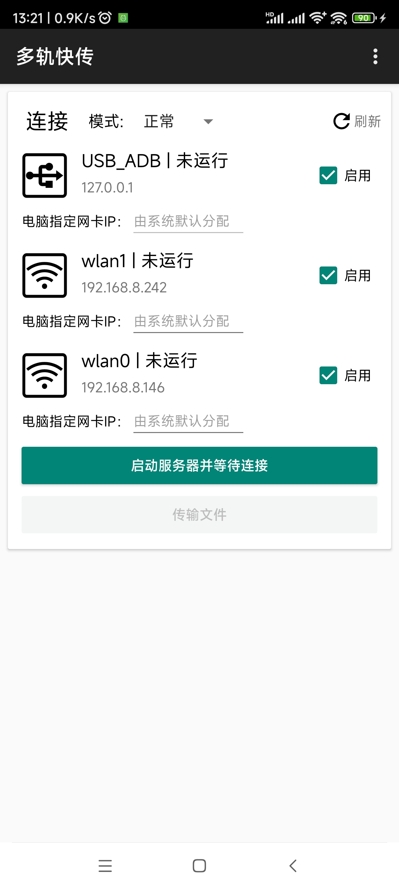
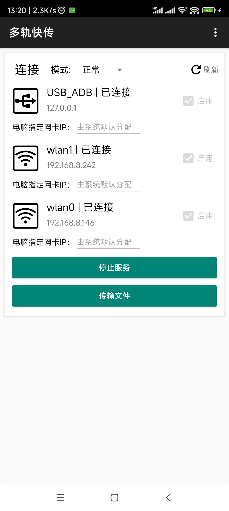
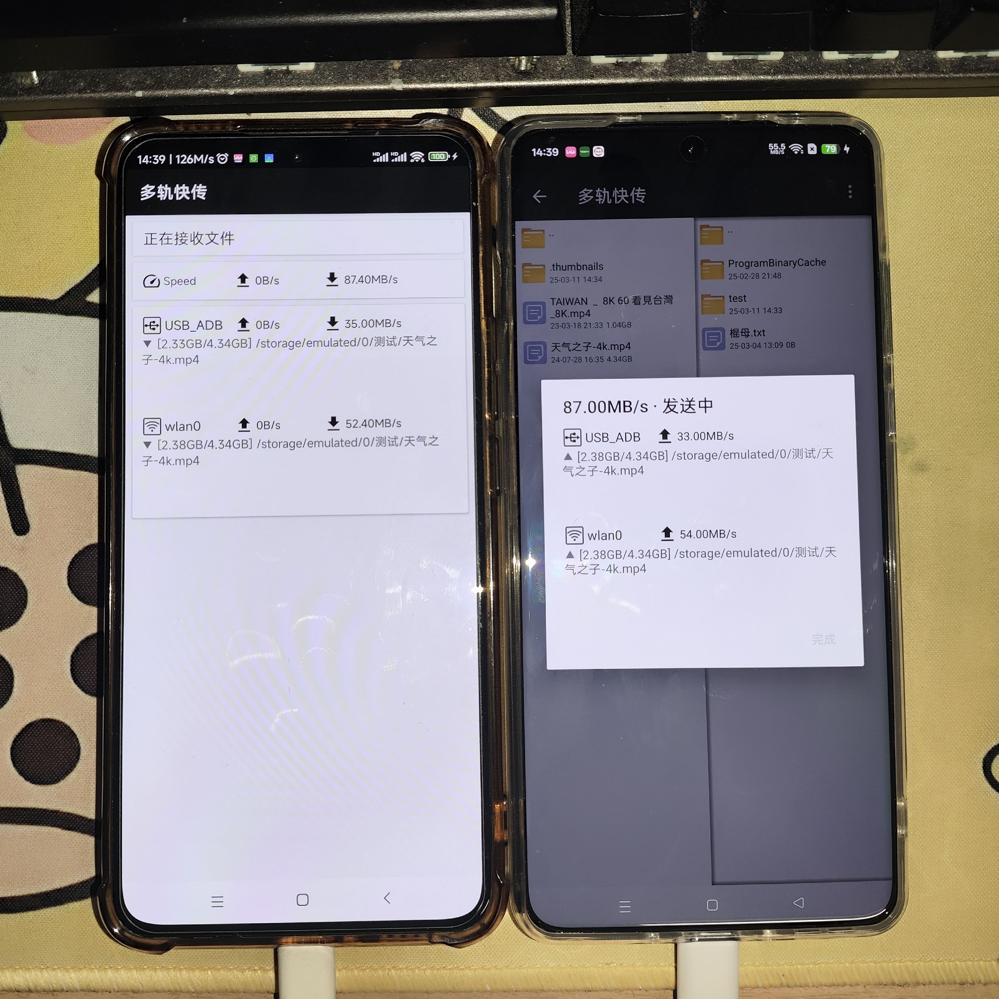
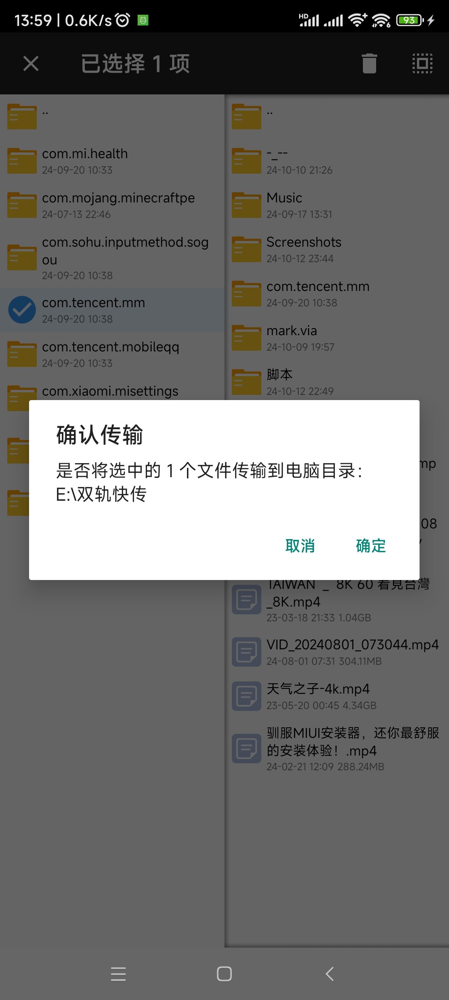
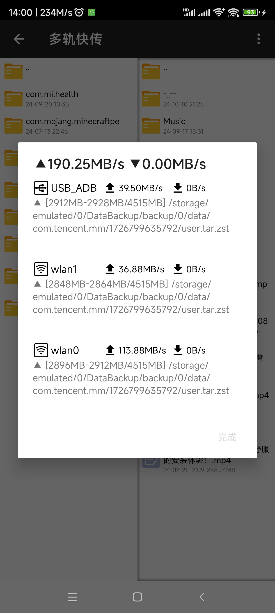
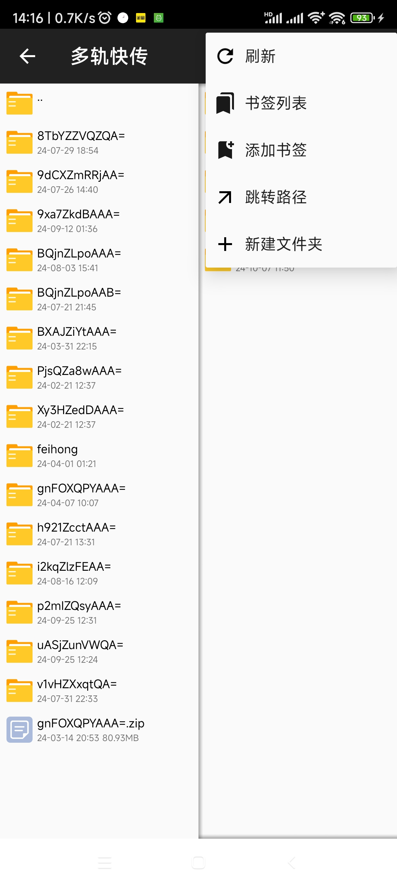
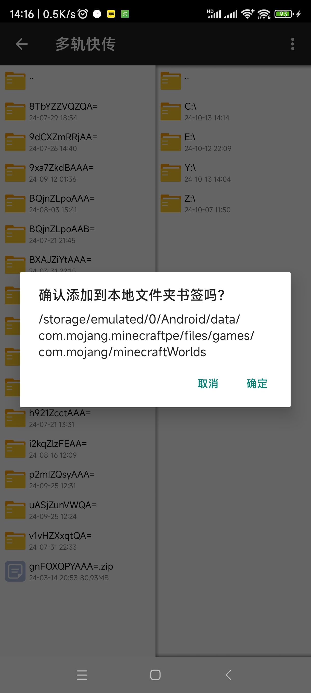
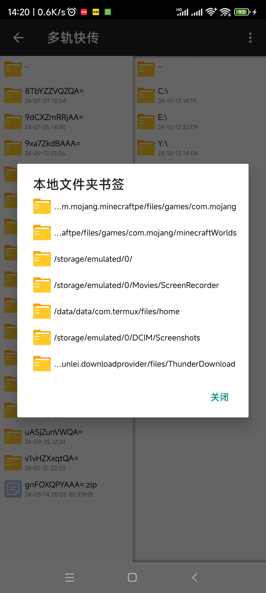

# 多轨快传

多轨快传（原双轨快传），一个可以同时使用USB和WIFI等多张网卡传输文件到电脑的软件。用尽手机一切对外可用IO通道，提升传输速度。

USB2.0+WIFI6（千兆网口）可以跑到150MB/s（40+110MB/s）！

USB2.0+WIFI6_5G:160mhz+WIFI6_2.4G:40mhz 可以跑到200+MB/s！

> **版本提示（4.0 预览版 / 协议 401）**：新版新增了电脑端图形界面、连接配对加密、临时文件保护、断点续传、分块 CRC32 校验与可选 SHA-256 校验，以及无需 Shizuku 的 Root（直接 su）模式。由于传输协议升级，**手机端与电脑端请同时升级到相同版本**，无法与 3.0 旧版混用。

## 速度测试（USB2.0+WIFI6:GbE）




# 使用

## 模式

手机端 I/O 服务支持四种启动模式：

- **正常模式**：无需额外授权，可访问手机内置存储的常规公共目录。
- **Root（直接 su）**：适合已安装 Magisk、KernelSU、APatch 等 Root 管理器的设备，直接通过 su 授权启动，无需先开启 Shizuku，权限最高（可访问 `/data`、`~/Android/data/` 及外置存储）。
- **Shizuku ROOT / Shizuku ADB**：依靠 Shizuku 启动。ROOT 权限最高；ADB 权限比正常模式略高一些（例如可访问部分外置 SD 卡目录）。

注意：`~/Android/data/` 目录在安卓 11 及以上需要 ROOT 权限（直接 su 或 Shizuku ROOT），普通模式和 ADB 模式无法直接读写。请不要指责我，感到不适请发邮件到谷歌安卓部那抗议！

## 网卡与通道

选择要用于传输的网卡，一个网卡一个通道。只要能被识别为网卡的，都会显示在网卡列表中，比如这些

- 连接一个WIFI
- 连接双WLAN加速的辅助WIFI
- 打开热点
- USB网络共享
- 蓝牙网络共享（不建议用）
- 物理以太网口
- VPN软件的TUN网卡（请勿选择）
- ~~蜂窝网络~~（已过滤，若有需要请修改编译源码）

请选择**可以同电脑进行局域网传输**的网卡

USB_ADB的连接比较特殊，它是通过`adb forward tcp:<port> tcp:<port>`转发命令实现的，将手机的端口转发到本机（127.0.0.1）上，使其能够通过USB进行网络传输。

## 连接

### 手机端

插上数据线并连接WIFI，WIFI**需要与电脑处在同一局域网内**（推荐电脑使用网线直连路由器）。

USB_ADB的连接需要USB调试，请到开发者选项中打开。**如果你因各种原因不能使用ADB，可以改用USB网络共享代替ADB。**

在主界面选择好模式与要使用的网卡后，点击『启动服务器并等待连接』，界面会显示当前会话的**配对码**与服务端口（默认 `5740`）。服务运行期间会保持前台通知，旋转屏幕或切到后台不会中断当前连接；如果准备锁屏长时间传输大文件，建议在系统省电设置中允许本应用后台运行。

|                        选择模式与网卡                        |                           电脑连接                           |
| :----------------------------------------------------------: | :----------------------------------------------------------: |
|  |  |

### 电脑客户端连接

4.0 版本提供了开箱即用的**桌面图形界面（推荐）**，同时也完整保留了**命令行模式（CLI）**。更详细的桌面端说明可参考 [DESKTOP.md](HybridFileXfer-PC/DESKTOP.md)。

#### 方式一：桌面图形界面（推荐）

- **便携版压缩包**：自带 Java 运行环境，解压后直接运行 `HybridFileXfer.exe`（Linux / macOS 运行包内对应程序）即可打开图形窗口，无需单独安装 Java。
- **单文件 JAR 包**：已安装 Java 8 及以上环境时，直接双击或执行 `java -jar HybridFileXfer.jar` 即可打开图形界面。

连接步骤：
1. 在电脑窗口选择连接方式（**USB 设备** 或 **手机网络地址**），并选择电脑端默认接收目录。
2. **USB (ADB) 连接**：只要电脑能通过 `adb` 识别到手机并已授权 USB 调试，配对码输入框留空即可——电脑端会自动读取手机当前会话的配对码与端口完成认证。勾选『连接时打开手机 App』后，还可以直接从电脑端唤醒手机端应用。
3. **无线局域网连接**：选择『手机网络地址』，填入手机的局域网 IP 和手机界面上显示的配对码，点击『开始连接』。
4. 勾选『自动等待与重连』后，可以先在电脑上点连接，等手机准备好后会自动连上。右上角支持切换跟随系统、浅色或深色外观主题。

#### 方式二：命令行模式（CLI）

通道分为控制通道与传输通道，控制通道用于通知对方发送或接收文件、列出文件夹、创建文件夹等，传输通道用于传输文件。在启动命令中传入 `-c` 等参数时会自动使用命令行模式。

**参数说明**

```text
HybridFileXfer — 桌面连接与传输客户端

  java -jar HybridFileXfer.jar                         打开桌面图形界面
  java -jar HybridFileXfer.jar --gui                   打开桌面图形界面
  java -jar HybridFileXfer.jar -c adb --launch-phone --wait
  java -jar HybridFileXfer.jar -c 192.168.1.2 --pairing-code-file code.txt

常用参数:
  -c, --connect ADDRESS      指定连接方式：adb 或手机局域网 IP（传入此参数即进入命令行模式）
  -s, --device ID            指定 USB 设备序列号
  -d, --dir DIRECTORY        设置电脑端初始目录（命令行默认 /，图形界面默认下载目录）
  -p, --port PORT            手机端服务端口（默认 5740）
      --local-port PORT      ADB 本地转发端口（默认 0，由系统自动分配空闲端口）
      --pairing-code CODE    指定手机端配对码（也可通过环境变量 HFX_PAIRING_CODE 传入）
      --pairing-code-file F  从 UTF-8 文本文件读取配对码（ADB 模式下留空会自动从手机读取）
      --launch-phone         连接时通过 ADB 唤醒手机端应用
      --wait                 未连上时自动等待并重试，按 Ctrl+C 停止
  -h, --help                 显示帮助信息
  -v, --version              显示版本信息
```

**完整启动命令示例**

```bash
# ADB 连接，自动唤醒手机端并等待连接（自动读取配对码）
java -jar HybridFileXfer.jar -c adb --launch-phone --wait

# 指定设备序列号与电脑接收目录
java -jar HybridFileXfer.jar -c adb -s abcd1234 -d C:\Users\Administrator\Desktop

# 局域网 IP 直连并传入配对码
java -jar HybridFileXfer.jar -c 192.168.1.2 --pairing-code 你的配对码
```

### 技巧

- 很多手机支持双WIFI加速，用上速度可以再增加！小米手机：WLAN => WLAN助理 => 智能多网加速 => 双WLAN加速，选择第二条不同频段的WIFI，可实现5Ghz+2.4Ghz加速！其他手机自行探索。**连上第二条WIFI后记得刷新下网卡列表**。

- 如果你没有路由器，但电脑有无线网卡，可以手机打开热点给电脑或反过来操作，即可建立电脑与手机之间的无线局域网，进行文件传输

- 如果5Ghz频段WIFI已可以跑满你电脑的千兆网口，你没有2.5G网口，如何通过双WLAN加速来提高传输速度？

  - 如果电脑还有一个无线网卡。电脑打开一个不同频段的热点，然后手机连接电脑的热点作为辅助WLAN。或者手机打开与已连接WIFI不同频段的热点（切勿相同频段，能打开成功但一定会干扰降速！），电脑连接手机开的热点。

  - 如果电脑有两个千兆网卡。方法一是网卡合并，效果最好但是难以操作。方法二：两条网线都插入路由器，此时两张网卡各自一个IP地址。手机开启双WLAN加速，连接两个频段的WIFI。返回软件，此时由于电脑两张网卡都连接着同一上级路由，若系统默认分配，可能双WLAN的流量都走同一张网卡！所以需要在手机上设置『电脑指定网卡IP』使这两条通道各自走独立的电脑网卡。各自填写上对应的电脑网卡IP即可。

## 其他设备

### Linux电脑

下载 Linux 便携包解压运行，或使用单文件 `HybridFileXfer.jar`（不带参数启动图形界面，带 `-c` 启动命令行）：

```shell
java -jar HybridFileXfer.jar
# 或使用命令行模式
java -jar HybridFileXfer.jar -c adb
```

虽然 Java 是跨平台的，但使用 ADB 模式时需要系统中安装了对应处理器架构（x86_64、ARM、RISC-V、龙芯等）的 `adb` 工具（通常安装 `android-tools` 即可）。如果不使用 ADB，也可以直接用 Wi-Fi 局域网或 USB 网络共享连接。

### ArchLinux 通过 AUR 安装

> **重要提示：** 
>
> 本项目的 issue 跟踪器 **仅用于** 讨论项目本身的 Bug 和功能请求。
> **请不要在这里提交任何与 AUR 打包、`PKGBUILD` 语法、`makepkg` 错误或 AUR 助手相关的问题。** 
> 如果你遇到 AUR 相关问题，请在 AUR **网页上的包评论区** 或向软件包维护者寻求帮助。

本项目已在 [Arch Linux 用户仓库 (AUR)](https://aur.archlinux.org/packages/hybridfilexfer-git) 上发布，你可以使用任何你喜欢的 AUR 助手进行安装，例如：
```bash
# 使用 yay
yay -S hybridfilexfer-git

# 使用 paru
paru -S hybridfilexfer-git
```
安装完成后，你可以通过在终端执行 `HybridFileXfer` 来启动电脑端。

### Mac电脑

可直接下载 macOS 桌面包运行，或安装 Java 与 Android platform-tools (`adb`) 后运行 `HybridFileXfer.jar`。

### 安卓手机

可在Termux里运行jar文件，具体教程自行搜索。

当然，不用这么麻烦，**本应用自带对传功能**。

主页右上角，『连接手机服务端』，请确保对方手机所勾选网卡IP可连上，可以是同一局域网WIFI或者是热点，控制器通道任选一个网卡IP即可，并填入对方手机显示的配对码。

**请注意**，不使用ADB转发请不要勾选网卡`USB_ADB`！

至于手机传手机如何利用USB通道？第一方案是OTG线或双头Type-c线，只不过有以下两个问题

- 若在手机端跑动USB连接的ADB，需要ROOT权限。
- 使用USB网络共享，安卓手机并不能使用

最终的解决方案是：将两台手机同时插到电脑上，用电脑进行转发。将服务端手机的端口用adb转发（forward）到电脑上，再将电脑上的端口用adb转发回（reverse）客户端手机。

两部手机插到电脑后，运行`USB-forward.bat`脚本（中文版本`USB-forward_中文.bat`），按照提示操作即可。

转发完毕后，即可勾选使用USB_ADB网卡。同时，控制通道也可以选择USB_ADB的本地地址127.0.0.1（不是必须的）



## 传输

连接成功后，点击传输文件按钮，即可开始选择文件进行传输。

UI是双排文件管理器（照搬的MT管理器）。左边文件列表是当前手机的文件列表，右边为电脑（或对端手机）的文件列表。

点击文件夹进入子目录，按手机的返回键，返回当前焦点所在目录的上一级。顶部工具栏还可以快速切换**最近目录**、**存储位置**以及查看**本机传输历史**。

- **选择与区间多选**：长按文件或文件夹进入选择模式；在选择模式下**再次长按另一个条目**，即可一次性选中两者之间的整段文件。
- **开始传输**：选好文件后，点击底部明确的传输方向按钮（**『手机 → 对端』** 或 **『手机 ← 对端』**，也可以再次长按已选条目）打开传输确认框，确认后即开始传输。

例如：/sdcard/ > [/sdcard/test/] ==> E:\\transfer\\ > [E:/transfer/test/]

|                                                              |                                                              |
| ------------------------------------------------------------ | ------------------------------------------------------------ |
|  |  |

传输完毕后，点击右上角“←”退出文件列表，点击停止服务器以正常断开与电脑的连接。

## 文件保护、断点续传与进度显示

为了避免断线或异常中断导致目标文件损坏，4.0 对传输流程做了全面升级（详细说明见 [docs/reliable-transfer.md](docs/reliable-transfer.md)）：

- **临时文件保护与同名文件策略**：接收文件时会先写入同目录下的临时文件（`.hfx-*.part`），全部数据写完并校验无误后才会转为正式文件，中断时不会破坏目录下原有的同名文件。遇到同名文件时默认**保留两份**，也可以在传输设置中改为**跳过**、**覆盖**，或开启**增量传输**（比对文件内容，内容完全一致时自动跳过）。
- **断点续传与单通道容错**：传输中断并重新连接后，再次选择同一批文件和目标目录即可自动核对已保存的部分并继续传输。多网卡同时传输时，如果某一条无线或有线通道中途断开，未传完的数据块会自动交给剩余正常通道继续传输。
- **CRC32 分块校验与可选 SHA-256 全文件校验**：每个数据块在传输时都会自动进行 CRC32 校验，发现损坏立即重传该分块，几乎不增加额外耗时。如果传输重要归档文件，可以在任意一端勾选**『传输后完整 SHA-256 校验』**，所有数据传完后两端会并发核对文件哈希，发现不一致会自动重传修复；校验期间也可随时点击『停止校验与重试』直接保留已收到的文件。
- **关于进度条与预扫描**：统计成千上万个零碎小文件的总大小非常耗时（例如相册或截图文件夹，光统计文件大小就可能占去总时间的 1/3！）。因此默认不预先扫描总大小，而是直接开始传输并实时显示**已传输字节数、当前文件及每条通道的分块进度**；如果你希望看到总进度百分比，可以在传输设置中勾选**『先扫描总量』**。

## 书签

v1.2.0新增书签功能。

### 添加书签

点击右上角菜单，添加书签。有两个书签列表，一个是**手机**，一个是**电脑**。若当前焦点是本地文件夹，确认后书签将添加至本地文件夹书签列表，若当前焦点是电脑文件夹，确认后书签将添加至电脑文件夹书签列表。

### 跳转书签

点击右上角菜单，书签列表。点击要跳转的书签即可跳转至目标目录。

| 右上角菜单                                                   | 添加书签                                                     | 书签列表                                                     |
| ------------------------------------------------------------ | ------------------------------------------------------------ | ------------------------------------------------------------ |
|  |  |  |

*演示中的~/Android/data/……目录需要root访问（安卓11以上）*

# 原理

将文件传给对方，发送方有一个读文件线程和多个网络发送线程，接收方有一个写文件线程和多个网络接收线程。首先由文件读取线程将文件读取到1MB的文件块中，再将块存到队列里，接着继续读到取下一个块。与此同时有多个传输线程同时向队列里取文件分块，然后向网络发送。接收端这里，多个接收线程都有它自己的队列，将接收的文件块插入队尾，与此同时，文件写入线程，获取所有队列队头索引值最小的一个文件块，将其写入硬盘。由于所有队列中，文件块都遵循从小到大的顺序（这就比如你将一组从小到大的数字，按顺序取出，再放到不同的新数组中，这些新的数组里的数字都遵循从小到大的顺序），这样取出来的文件块，索引就是连续的。若网速比硬盘写入速度快时，写入是顺序的，提升机械硬盘这种设备的性能。若网速比硬盘写入速度慢时，由于一接收到块就立刻被写到硬盘里了，写入就是随机的。具体请查看源码

# 魔法

禁止以任何形式在飞机杯社区（酷安）分享本软件，否则后果自负！


酷安斐济杯文章来源[https://mp.weixin.qq.com/s/gt8DiwC3kWmyzjLCze1TRg](https://mp.weixin.qq.com/s/gt8DiwC3kWmyzjLCze1TRg)

# 赞助

前赞助计划[2.5G-WIFI6 GL-MT6000 路由器](https://m.tb.cn/h.gcb0Q6flYgnOqrX?tk=ubRnWtrez83)，已通过大家的赞助+自己的费用购买到，谢谢大家的赞助！

喜欢本软件可以赞助支持！请备注“赞助双轨快传-[你的github ID]”。所有赞助名单都将公布！若你想匿名赞助，请填写备注`赞助双轨快传`但不备注你的信息，**否则我无法判断收款码收款意图！将不会纳入赞助名单！**

[查看赞助名单](./赞助名单.md)


## 许可证

本项目使用的JDK来源于 **Dragonwell JDK**，该部分代码受到 **GNU General Public License version 2 (GPL-2.0)**，并且附加 **Classpath Exception** 的保护。**Dragonwell JDK** 的许可证原文请参见 [Dragonwell JDK License](https://github.com/dragonwell-project/dragonwell21/blob/master/LICENSE)。

本项目整体使用 **GNU General Public License version 3 (GPL-3.0)**，许可证文件可以在 [LICENSE](./LICENSE.txt) 文件中找到。新增及修改说明见 [CHANGES.md](./CHANGES.md)，第三方依赖库（FlatLaf、libsu）的 Apache-2.0 许可声明见 [THIRD_PARTY_NOTICES.txt](./THIRD_PARTY_NOTICES.txt)。

### Dragonwell JDK License

**Dragonwell JDK** 的代码基于 **GPL-2.0** 发布，并附有 **Classpath Exception**。这些条款允许您将该库与其他独立的模块链接，以创建和分发符合其他许可证要求的可执行文件。

特别说明：

- 如果你将本项目进行分发，务必保留 **Dragonwell JDK** 的版权声明和许可证原文。
- 本项目中的其他部分基于 **GPL-3.0**，这意味着任何对本项目的修改和分发必须符合 GPL-3.0 的条款。

## 声明

任何人都可自由提交PR，只要你的代码对该项目有帮助！欢迎会编写程序的你提交代码为此项目做贡献，而不是只会在Issues里提一些稀奇古怪的建议。

PR列表个人头像表达含义属于他们的自由。与本项目主无关！

## Star History

[](https://star-history.dera.page/#weixiansen574/HybridFileXfer&Date)
